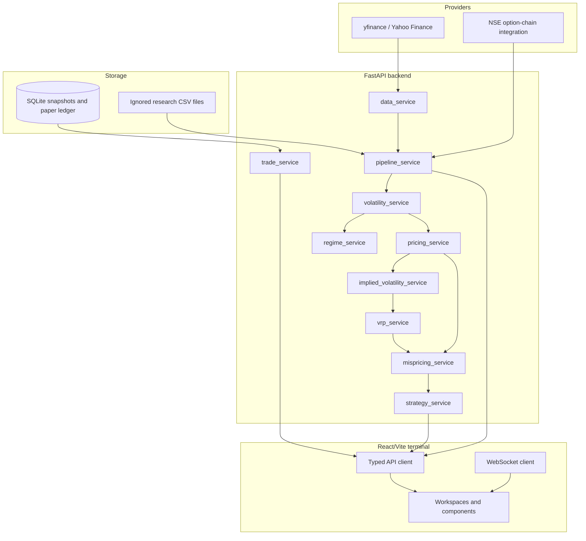
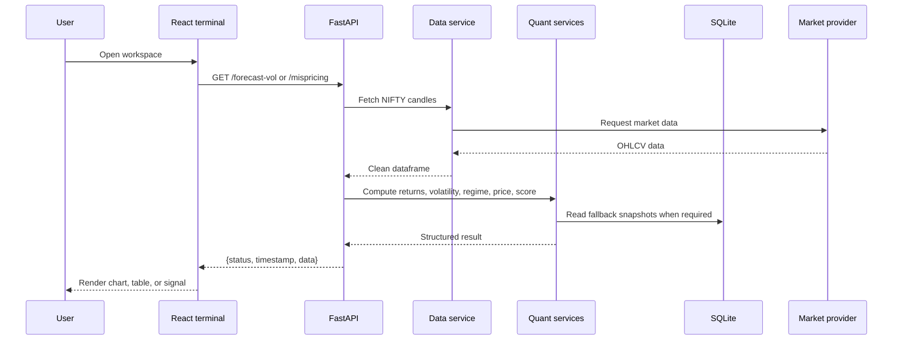
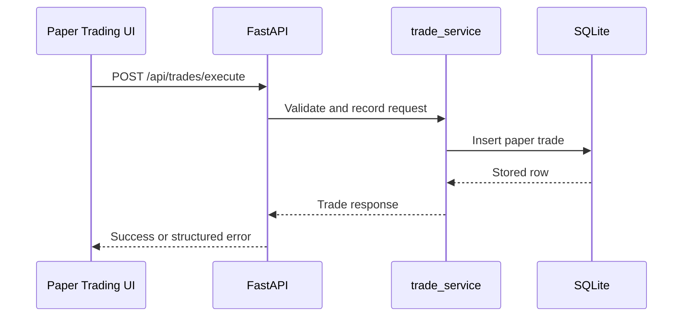

# Internal Project Explanation

This is the internal reference for `[NEEDS INPUT: Your name]`, Heet, and Shaurya. It explains what the repository actually contains, how the pieces connect, how to demonstrate it, and which claims must be made carefully.

## 1. The project in three sizes

### One sentence

The NIFTY 50 Options Mispricing Detection Engine is a Python and React research terminal that combines market data, volatility models, option pricing, regime classification, mispricing scores, strategy suggestions, and backtesting.

### One paragraph

The system has a FastAPI backend and a React/Vite frontend. The backend obtains NIFTY 50 index data through `yfinance`, obtains option-chain information through its live option-chain service, calculates log returns, forecasts volatility with EGARCH, classifies volatility regimes with a Gaussian HMM, prices options with a dividend-adjusted Black–Scholes–Merton model, calculates Greeks, estimates implied volatility and VRP, and produces a composite mispricing score. The frontend calls these APIs and presents them as terminal workspaces. SQLite stores option snapshots and paper-trading records. Separate research scripts evaluate historical forecasts, historical option valuation, and daily-options backtests. These are related experiments, but the repository does not prove that they form one economically validated profitable trading system.

### Five-minute story

1. **Start with the problem.** NIFTY 50 has many option contracts. Each contract has a strike, expiry, option type, price, volume, open interest, and changing sensitivity to the index.
2. **Bring in observations.** The application fetches index candles and option-chain data. It also has local SQLite storage for snapshots and paper trades.
3. **Measure market movement.** Closing prices become log returns. The volatility service fits an EGARCH model to daily returns and can calculate intraday realised volatility from five-minute prices.
4. **Estimate market mood.** A Gaussian HMM groups observed volatility values into ordered low, normal, high, or extreme regimes.
5. **Estimate option value.** The pricing service applies Black–Scholes–Merton with interest rate, dividend yield, volatility, spot, strike, and time to expiry. It also calculates delta, gamma, theta, and vega.
6. **Compare and score.** The mispricing service compares observed market price with theoretical price. It adds normalised price deviation, volatility-risk-premium deviation, Greeks components, and a timeframe-coherence multiplier into an M-Score.
7. **Suggest, do not guarantee.** The strategy service turns the available signal into a long-volatility, short-volatility, or no-trade recommendation.
8. **Show the result.** The API returns JSON. The React terminal displays the result in workspaces.
9. **Evaluate carefully.** Research scripts run chronological experiments. The historical research evidence has important limitations: daily close data is not the same as executable bid/ask data, and paper trading is not broker execution.

> **Explain like I’m 10:** We watch a big basket of 50 companies. We measure how jumpy it is, guess what an option should cost, compare that guess with the observed price, and show the result on a screen. A different price is a warning light, not proof that someone made a mistake.

## 2. Explain like I’m 10

Imagine a weather station for a market:

- **Index price:** The thermometer reading for the NIFTY 50.
- **Return:** How much the thermometer changed since yesterday.
- **Volatility:** How jumpy the thermometer has been.
- **EGARCH:** A machine that learns whether jumpiness tends to continue.
- **HMM:** A machine that guesses whether the weather is calm, normal, stormy, or extreme.
- **Option:** A ticket that gives someone a right to buy or sell later.
- **Black–Scholes price:** A calculator for a reasonable ticket price under assumptions.
- **Greek:** A label saying how the ticket price changes if one input changes.
- **Mispricing score:** A warning-light score showing how different the observed price is from the calculator.
- **Backtest:** A replay of old days to see what a rule would have done.
- **Paper trading:** Pretend trading with records, not real broker orders.

## 3. Real-world problem

An option price is not determined by one number. It depends on:

- current index level;
- strike price;
- time to expiry;
- expected volatility;
- interest rate;
- dividend yield;
- option type;
- liquidity and market microstructure.

The system makes those inputs visible and repeatable. It helps a researcher inspect the entire path from raw data to signal.

It does **not** solve the full problem of proving arbitrage. A model price can differ from a last-traded price because of stale quotes, bid/ask spreads, volatility smiles, dividends, liquidity, or model error.

> **Interview answer:** We framed the project as an explainable research and decision-support engine, not as a guaranteed-profit machine. This is more honest because model-versus-market differences are not automatically tradable mispricing.

## 4. Glossary

| Term | Simple meaning |
|---|---|
| API | A defined way for one program to request data from another program. |
| Annualisation | Converting a volatility measured over one interval into an annual scale. |
| ATM | At the money; strike is near the current underlying price. |
| Backtest | Replaying a historical period using a fixed strategy rule. |
| BSM / Black–Scholes–Merton | A mathematical option-pricing model. |
| CE / call | An option that gives a right to buy. |
| CORS | A browser rule controlling which origins may call an API. |
| Delta | Approximate option-price change for a one-unit underlying-price change. |
| DTE / TTM | Days to expiry / time to maturity. |
| EGARCH | Exponential GARCH; a volatility model using log variance and allowing asymmetry. |
| FastAPI | Python framework used to expose HTTP endpoints. |
| Gamma | How quickly delta changes when the underlying moves. |
| Greek | A sensitivity measure for an option. |
| HMM | Hidden Markov Model; a model that infers hidden states from observed values. |
| Implied volatility | Volatility inferred by solving a pricing model against a market price. |
| IV | Implied volatility. |
| JSON | Common text format for structured data exchange. |
| Log return | `ln(price_today / price_previous)`. |
| LTP | Last traded price. |
| MAE | Mean absolute error. |
| M-Score | This project’s composite mispricing score. |
| OI | Open interest; outstanding option contracts. |
| PE / put | An option that gives a right to sell. |
| QLIKE | A loss function for comparing variance forecasts. |
| Regime | A period with a particular market behaviour. |
| RMSE | Root mean squared error. |
| SQLite | A database stored in a local file. |
| Theta | Approximate time-decay sensitivity. |
| Vega | Approximate sensitivity to volatility. |
| VRP | Volatility risk premium; here calculated as implied volatility minus forecast volatility. |
| WebSocket | A long-lived connection for server-to-client updates. |

## 5. High-level architecture



> **Explain like I’m 10:** The providers are ingredients. The backend is the kitchen. The frontend is the menu and serving counter. SQLite is the notebook where the kitchen writes down what happened.

## 6. Request and data flow



For paper-trading actions:



## 7. Component breakdown

### Frontend

The frontend entry point is [frontend/src/App.tsx](frontend/src/App.tsx). It:

- connects the WebSocket when mounted;
- applies theme and density settings;
- maps keyboard shortcuts to workspaces;
- renders the selected workspace;
- mounts the header, sidebar, status bar, command palette, and contract drawer.

Important workspaces include:

- `OverviewWorkspace`
- `OptionsChainWorkspace`
- `VolatilityLabWorkspace`
- `MispricingScannerWorkspace`
- `StrategyLabWorkspace`
- `BacktestingWorkspace`
- `PaperTradingWorkspace`
- `HistoricalLedgerWorkspace`
- `RiskPortfolioWorkspace`
- `PipelineFlowWorkspace`
- `ModelRegistryWorkspace`

The typed client is [frontend/src/services/api.ts](frontend/src/services/api.ts). It normalises success envelopes, HTTP errors, timeouts, and network failures. The default request timeout is 12 seconds.

### Backend

[main.py](main.py) creates the FastAPI application, registers CORS, defines response envelopes, records simple in-memory metrics, and exposes endpoints.

The backend is service-oriented, but it is not a separate microservice deployment. Most services are imported into one Python process.

### Database

The default SQLite file is `data/nifty_live_snapshots.db`, which is intentionally ignored by Git. The database is used for local snapshots and paper-trading state.

### External services

- `yfinance` fetches index data and some fallback spot data.
- `pnsea` is listed as a dependency and used by the option-chain integration.
- NSE data is used by research/data-ingestion paths, but the data files are not included in the Git repository.
- `[NEEDS INPUT: Confirm any news provider used by /api/news.]`

### Authentication

The inspected application code does not show user authentication or authorization middleware. The API should therefore be treated as a trusted local/development service unless deployment configuration adds protection.

## 8. Folder and file walkthrough

### Root files

| Path | Purpose |
|---|---|
| `main.py` | FastAPI application, helpers, endpoints, WebSocket, and frontend serving. |
| `requirements.txt` | Python dependency list. |
| `Dockerfile` | Python 3.10 container that installs requirements and starts Uvicorn. |
| `.env.example` | Configuration names and safe example values. |
| `.gitignore` | Ignores local data, outputs, secrets, caches, and frontend build files. |
| `run_validation.py` | Validation entry point; inspect before presenting it as the full test suite. |

### Backend

| Path | Purpose |
|---|---|
| `backend/services/data_service.py` | Fetches provider candles and computes log returns. |
| `backend/services/volatility_service.py` | EGARCH forecast, realised volatility, and fusion. |
| `backend/services/regime_service.py` | Gaussian HMM fitting and regime labels. |
| `backend/services/pricing_service.py` | BSM pricing, Greeks, and time-to-maturity. |
| `backend/services/implied_volatility_service.py` | Implied-volatility inversion and spread classification. |
| `backend/services/vrp_service.py` | VRP calculation and rolling state. |
| `backend/services/mispricing_service.py` | Deviation, M-Score, z-score, and classification. |
| `backend/services/strategy_service.py` | Long-vol, short-vol, or no-trade recommendation. |
| `backend/services/option_chain_service.py` | Live chain, cache, filtering, and SQLite fallback. |
| `backend/services/db_service.py` | `option_ticks` SQLite schema and aggregation. |
| `backend/services/trade_service.py` | Paper-trade ledger queries and performance metrics. |
| `backend/services/backtest_service.py` | Backtest endpoint service. |
| `backend/services/csv_options_backtest_engine.py` | CSV-based options backtest support. |
| `backend/infrastructure/timeframe_config.py` | Supported timeframes and annualisation settings. |
| `backend/infrastructure/timeframe_adapter.py` | Timeframe dataframe normalisation. |
| `backend/infrastructure/annualization_engine.py` | Dynamic annualisation helper. |

### Frontend

| Path | Purpose |
|---|---|
| `frontend/src/App.tsx` | Root React shell and workspace switcher. |
| `frontend/src/services/api.ts` | Typed REST client. |
| `frontend/src/services/websocket.ts` | Market update connection. |
| `frontend/src/stores/terminalStore.ts` | UI state such as active workspace and theme. |
| `frontend/src/components/` | Shared UI elements. |
| `frontend/src/workspaces/` | Main product screens. |
| `frontend/package.json` | Frontend scripts and dependencies. |

### Research and validation

| Path | Purpose |
|---|---|
| `scripts/run_empirical_research.py` | Walk-forward volatility, HMM, and historical option valuation research. |
| `scripts/run_phase2_horizon_validation.py` | Horizon-aligned EGARCH valuation validation. |
| `scripts/research_backtest/engine.py` | Separate daily-options research backtest. |
| `scripts/record_nifty_snapshots.py` | Snapshot recording. |
| `scripts/live_paper_trader.py` | Paper-trading process. |
| `scripts/validate_nse_options_dataset.py` | Dataset validation. |
| `docs/research/` | Source-level audits and research reports. |

## 9. Important functions and modules

| Function | Inputs | Output | Why it exists |
|---|---|---|---|
| `fetch_nifty_data` | symbol, timeframe | OHLCV dataframe | Gets and normalises index candles. |
| `compute_log_returns` | dataframe with `Close` | dataframe with `log_return` | Creates the model input. |
| `forecast_volatility` | daily returns, optional five-minute prices | daily, intraday, final volatility, TCI | Estimates and fuses volatility. |
| `classify_volatility_regime` | current volatility, history, state count | regime ID, label, confidence | Maps market conditions to a regime. |
| `black_scholes_price` | spot, strike, TTM, rate, vol, option type | price | Computes theoretical option value. |
| `calculate_greeks` | same pricing inputs | delta, gamma, theta, vega | Measures price sensitivities. |
| `calculate_implied_volatility` | observed price and option inputs | implied volatility | Inverts pricing relationship. |
| `compute_vrp` | IV, forecast volatility, regime | current/expected VRP and standard deviation | Tracks IV minus forecast volatility. |
| `detect_mispricing` | market price, fair price, optional score inputs | deviation, class, M-Score, z-score | Converts model differences into a structured signal. |
| `generate_strategy` | classification, regime, score, IV, forecast volatility | strategy structure and risk notes | Produces a decision-support suggestion. |
| `get_trades_overview` | optional date filter | summary, trades, equity curve | Reads paper-trading performance. |

### Volatility fusion

`forecast_volatility` fits EGARCH to `returns_series * 100`, forecasts one step, divides the square-rooted percentage variance by `100`, and annualises it. It also calculates intraday realised volatility from five-minute prices. The configured weights are:

- daily: `VOL_FUSION_DAILY_WEIGHT`, default `0.7`;
- intraday: `VOL_FUSION_INTRADAY_WEIGHT`, default `0.3`.

If intraday data is unavailable, the service normalises to daily weight `1.0` and intraday weight `0.0`.

> **Interview answer:** The fusion keeps the model forecast and realised intraday signal separate until the final weighted value. That makes missing intraday data explicit instead of silently pretending it exists.

### HMM regime classification

`regime_service.py`:

1. removes non-finite volatility observations;
2. requires at least `REGIME_MIN_SAMPLES`, default `120`;
3. fits `GaussianHMM` with diagonal covariance, up to 500 iterations, and `random_state=42`;
4. orders hidden states by fitted mean volatility;
5. labels them as low, normal, high, or extreme;
6. predicts the state probability for the current volatility.

The live configuration defaults to four states. The function also supports a three-state mapping.

### Pricing and Greeks

The pricing service uses continuous dividend yield. For a call:

\[
C=S e^{-qT}N(d_1)-K e^{-rT}N(d_2)
\]

For a put:

\[
P=K e^{-rT}N(-d_2)-S e^{-qT}N(-d_1)
\]

The service floors time-to-expiry at 15 minutes when calculating TTM to avoid a numerical singularity. Invalid or zero inputs return intrinsic value or zero according to the branch in the code.

### M-Score

`detect_mispricing` starts with:

```text
deviation = (market_price - fair_price) / fair_price
```

It then:

1. normalises price deviation by multiplying by `20`;
2. computes VRP deviation as current VRP minus expected VRP;
3. normalises VRP deviation by multiplying by `50`;
4. scales vega and gamma into bounded components;
5. applies the sign of price deviation to Greeks;
6. applies a timeframe-coherence multiplier;
7. combines weighted components;
8. forces strong price-deviation sign consistency;
9. labels the result:
   - `overpriced` if deviation is above `0.05` or M-Score is at least `1.2`;
   - `underpriced` if deviation is below `-0.05` or M-Score is at most `-1.2`;
   - otherwise `fair`;
10. appends the M-Score to a process-global deque and calculates a z-score.

The default weights declared in the module are price `0.50`, vega `0.15`, gamma `0.15`, TCI `0.10`, and VRP `0.10`. The code’s active calculation uses explicit price, VRP, vega, and gamma weights and applies TCI as a multiplier. This implementation detail should be explained accurately rather than describing it as five simple additive terms.

> **Interview answer:** We made the score compositional so users can inspect the reason for a signal. The main weakness is that the score includes stateful normalisation and hand-tuned scales; it should not be treated as a universal statistical truth.

## 10. Database schema

### `option_ticks`

Created by `DBService._init_db` in `backend/services/db_service.py`:

| Column | Meaning |
|---|---|
| `id` | Auto-increment identifier |
| `instrument_key` | Contract identifier |
| `symbol` | Underlying symbol |
| `strike` | Option strike |
| `option_type` | Call/put representation |
| `expiry` | Contract expiry |
| `timestamp` | Tick time |
| `open`, `high`, `low`, `close` | Price fields |
| `volume` | Traded volume |
| `oi` | Open interest |

The service indexes symbol/time and instrument/time. It can resample one-minute records into five-minute or other bars.

### `option_snapshots`

The option-chain service creates a snapshot table with:

`timestamp`, `symbol`, `spot_price`, `expiry_date`, `strike`, `option_type`, `ltp`, `iv`, `oi`, `volume`, `bid`, `ask`, `delta`, `gamma`, `theta`, and `vega`.

### `live_paper_trades`

The exact table-creation statement is not in the inspected `trade_service.py`; it queries this table. `[NEEDS INPUT: Document the authoritative schema creator for live_paper_trades.]`

## 11. API endpoints and interfaces

Most successful responses use:

```json
{
  "status": "success",
  "timestamp": "...",
  "data": {},
  "meta": {}
}
```

| Method | Endpoint | Purpose |
|---|---|---|
| GET | `/api/status` | Basic running status. |
| GET | `/health` | Lightweight service health. |
| GET | `/metrics` | In-memory request and last-result metrics. |
| GET | `/nifty` | NIFTY candles; query `symbol`, `timeframe`. |
| GET | `/returns` | Log-return data; query `symbol`, `timeframe`. |
| GET | `/forecast-vol` | Annualised volatility forecast. |
| GET | `/fair-price` | BSM theoretical price. |
| GET | `/mispricing` | Price deviation and M-Score. |
| GET | `/regime` | HMM regime classification. |
| GET | `/strategy` | Strategy recommendation. |
| GET | `/expiries` | Available expiries. |
| GET | `/backtest` | Backtest result or computed backtest. |
| GET | `/backtest/report/download` | HTML research report download. |
| GET | `/backtest/report/markdown` | Markdown research report download. |
| GET | `/option-chain` | Option-chain endpoint with depth and optional expiry. |
| GET | `/api/trades` | Paper-trading overview. |
| POST | `/api/trades/execute` | Record a paper trade request. |
| POST | `/api/trades/close` | Close a paper trade. |
| GET | `/api/news` | Market news response; provider details need confirmation. |
| GET | `/api/health` | Detailed health check. |
| GET | `/api/model-registry` | Model metadata and validation information. |
| GET | `/api/risk` | Portfolio risk and stress information. |
| GET | `/api/pipeline-flow` | Pipeline stage telemetry. |
| GET | `/api/volatility-surface` | Volatility surface response. |
| WebSocket | `/ws`, `/ws/market` | Market/tick streaming endpoint. |

Exact request and response schemas should be checked in `/docs` because several endpoint implementations are long and some payloads depend on live data or local files.

## 12. Algorithms and business rules

### Data and returns

1. Map `NIFTY` to Yahoo symbol `^NSEI`.
2. Choose a provider period and interval from the requested timeframe.
3. Download OHLCV data.
4. Flatten multi-index columns.
5. Drop empty rows.
6. Require at least 100 rows.
7. Keep at most the latest 2,000 rows.
8. Convert timestamps to India Standard Time.
9. Compute log returns from close prices.

### Option-chain filtering

The option-chain service uses configurable liquidity filters. The thresholds live in `option_chain_filters.py`; inspect that file before stating exact production thresholds in a presentation.

### Strategy decision

If a quantifiable volatility edge and z-score are available:

- long volatility when forecast/adjusted volatility exceeds IV by at least the configured threshold and the z-score is sufficiently negative;
- short volatility when IV exceeds forecast/adjusted volatility by at least the configured threshold and the z-score is sufficiently positive;
- avoid a long-volatility signal in `EXTREME_VOL`;
- otherwise return `NO_TRADE`.

If quantitative inputs are missing, the service falls back to the legacy mispricing label.

### Research experiments

The research scripts are not identical to the live service:

- `run_empirical_research.py` evaluates chronological volatility forecasts, HMM diagnostics, and historical BSM valuation.
- `run_phase2_horizon_validation.py` evaluates maturity-aligned EGARCH approximations.
- `scripts/research_backtest/engine.py` is a separate daily-options backtest.

The `data/` directory is ignored, so these experiments cannot be reproduced from a clean clone without separately supplied datasets.

## 13. Security, authentication, and privacy

### Observed facts

- `.env` exists locally and is ignored; never commit it.
- `.env.example` contains configuration names, not secret values.
- CORS is configured with `allow_origins=["*"]` and credentials enabled in `main.py`.
- No authentication middleware was found in the inspected application entry point.
- Paper-trading endpoints can change local SQLite state.

### Practical rules

- Do not put API keys or broker credentials in Markdown, code, commits, screenshots, or logs.
- Use environment variables for secrets.
- Do not expose the development server publicly without authentication, restricted CORS, HTTPS, and network controls.
- Treat market data, trade records, and account information as sensitive operational data.
- Validate all external input and avoid accepting arbitrary file paths.

> **Interview answer:** The current repository is a local research/paper-trading application, not an internet-hardened multi-user platform. Production deployment would require authentication, authorisation, secret management, restricted CORS, HTTPS, audit logs, and stronger input controls.

## 14. Configuration

Important names from `.env.example`:

| Variable | Meaning | Default shown |
|---|---|---|
| `REGIME_STATE_COUNT` | HMM state count | `4` |
| `REGIME_MIN_SAMPLES` | Minimum HMM observations | Code default `120` |
| `VOL_FUSION_DAILY_WEIGHT` | Daily-volatility weight | `0.7` |
| `VOL_FUSION_INTRADAY_WEIGHT` | Intraday-volatility weight | `0.3` |
| `VRP_ROLLING_WINDOW` | VRP history length | `60` |
| `RISK_FREE_RATE` | Default annual rate | `0.065` |
| `STRIKE_EXPANSION` | Chain strike expansion | `15` |
| `NIFTY_LOT_SIZE` | Lot size setting | `65` |
| `MAX_CONTRACT_POSITIONS` | Position limit | `1` |
| `MAX_ABS_NET_DELTA` | Absolute delta limit | `100` |
| `MAX_CHAIN_AGE_SECONDS` | Maximum chain age | `30` |
| `ALLOW_STALE_CHAIN` | Offline replay fallback | `0` |
| `MSCORE_W1` ... `MSCORE_W5` | M-Score weight overrides | Code defaults |
| `MSCORE_Z_WINDOW` | M-Score z-score window | `60` |

Do not copy `.env` values into documentation.

## 15. Local setup and common errors

### Setup

```powershell
python -m venv .venv
.venv\Scripts\Activate.ps1
pip install -r requirements.txt
uvicorn main:app --reload --port 8000
```

In another terminal:

```powershell
cd frontend
npm install
npm run dev
```

### Common errors

| Error | Likely reason | Fix |
|---|---|---|
| `ModuleNotFoundError` | Python dependencies are missing | Activate the intended virtual environment and run `pip install -r requirements.txt`. |
| Empty provider response | Network, symbol, rate limit, or provider restriction | Check connectivity, symbol, timeframe, and provider limits. |
| Fewer than 100 candles | Provider returned too little data | Use a supported timeframe with a longer provider window. |
| Frontend request timeout | Backend is not running or provider call is slow | Start backend, check port 8000, and inspect backend logs. |
| No historical research data | `data/` is intentionally ignored | Obtain the documented datasets separately. |
| HMM cannot fit | Too few or invalid volatility observations | Provide at least the configured minimum finite observations. |
| SQLite table missing | Required local DB has not been initialised | Start the relevant snapshot/paper-trading path and inspect logs. |
| Port already in use | Another service owns the port | Stop it or choose another port. |

## 16. Testing strategy

The repository includes frontend test scripts and a `tests/` directory, but the complete automated test contract should be documented before claiming full coverage.

Useful checks:

```powershell
python -m compileall main.py backend scripts
cd frontend
npm run build
node test_quant_terminal.mjs
node test_full_quant_system.mjs
```

Manual smoke test:

1. Open `/health`.
2. Open `/api/status`.
3. Open `/docs`.
4. Try `/nifty?symbol=NIFTY&timeframe=daily`.
5. Try `/forecast-vol?symbol=NIFTY&timeframe=daily`.
6. Open the frontend and check the Overview, Option Chain, Volatility, Mispricing, and Risk workspaces.
7. Confirm that failed provider requests show an error rather than a fake success.

`[NEEDS INPUT: Add the authoritative CI command and expected test coverage.]`

## 17. Deployment and CI/CD

### Container deployment

The `Dockerfile`:

1. starts from `python:3.10-slim`;
2. installs build, Fortran, and OpenBLAS packages;
3. installs `requirements.txt`;
4. copies the repository;
5. exposes port 8000;
6. starts Uvicorn.

### CI/CD

No complete CI workflow was confirmed in the inspected files.

`[NEEDS INPUT: Add GitHub Actions, hosting provider, deployment URL, environment secrets process, and rollback procedure.]`

## 18. Performance, scalability, and tradeoffs

- Provider requests are simpler than operating a dedicated market-data bus.
- In-memory caches reduce repeated option-chain calls, but they are process-local.
- SQLite is simple and useful for local paper trading, but it is not a horizontally scaled database.
- HMM models are cached globally in the Python process.
- VRP and M-Score histories are held in process-global deques, so they reset on process restart and can mix sessions if one process serves multiple contexts.
- CORS is permissive for development convenience.
- A single FastAPI process is easy to understand, but long provider/model calls can affect request latency.
- For larger scale, use a managed database, a market-data ingestion service, background jobs, per-symbol state, authentication, and metrics/tracing.

> **Interview answer:** We chose simple local components first because the project is a research terminal. The tradeoff is that reproducibility and clarity are strong, while multi-user isolation, persistence guarantees, and horizontal scaling need more work.

## 19. Edge cases and failure scenarios

- Empty provider response: raises an explicit error.
- Fewer than 100 candles: rejected by the data service.
- Invalid symbol: rejected by `validate_symbol`.
- Invalid or zero pricing inputs: handled by intrinsic-value or zero branches.
- Invalid market/fair price: mispricing returns a neutral `fair` response with zeroed score fields.
- Missing intraday prices: volatility fusion falls back to daily weight.
- HMM history too short: the service returns a normal-volatility fallback with zero confidence.
- HMM model fitting failure: endpoint-level error handling reports failure.
- Missing chain: option-chain logic may read local SQLite fallback; stale-chain use is configurable.
- Network timeout: frontend reports a 12-second timeout.
- Database lock or corruption: must be handled operationally; `[NEEDS INPUT: Add recovery procedure.]`

## 20. Why this technology stack

- **Python:** Strong scientific-computing ecosystem and readable research code.
- **FastAPI:** Clear endpoint declarations, automatic OpenAPI documentation, and good Python typing.
- **Pandas/NumPy:** Natural tools for time series and numerical arrays.
- **`arch` and `hmmlearn`:** Existing libraries for the required statistical models.
- **React/TypeScript:** Component-based interface with safer frontend data handling.
- **Vite:** Fast local frontend feedback.
- **SQLite:** Minimal setup for local snapshots and paper ledgers.
- **Docker:** Repeatable backend packaging.

## 21. Interview questions and strong answers

### 1. What does the project do?

It is a NIFTY 50 options analytics terminal. It fetches market data, forecasts volatility, prices options, computes Greeks, scores price differences, classifies regimes, and supports paper-trading and backtesting workflows.

### 2. What was the hardest part?

The hardest part was keeping the data flow honest across live data, model outputs, option prices, and research backtests. A model output is not automatically executable market evidence.

### 3. Why use EGARCH?

EGARCH models log variance and can represent asymmetric responses to shocks. We use it as a volatility input, not as proof that it is always the best model.

### 4. Why use an HMM?

An HMM provides a compact way to describe changing volatility conditions. The states are inferred from data and then ordered by fitted volatility means.

### 5. What is mispricing here?

It means the observed market price differs from the model reference price enough to trigger the project’s rules. It does not mean proven arbitrage.

### 6. How is the M-Score built?

It combines normalised price deviation, VRP deviation, directional Greek components, and a TCI multiplier, then applies sign and threshold rules.

### 7. What is VRP?

The current implementation calculates IV minus forecast volatility and keeps rolling global and regime-specific histories.

### 8. Why Black–Scholes?

It is transparent, fast, and easy to explain. Its limitations, especially constant-volatility and smile assumptions, are explicitly important.

### 9. What data providers are used?

The code uses `yfinance` for NIFTY data and has NSE/pnsea option-chain integration. Historical research files are local ignored data.

### 10. How does the frontend communicate?

The TypeScript API client sends HTTP requests to FastAPI. The WebSocket service handles streaming market updates.

### 11. Is there authentication?

No authentication middleware was confirmed in the inspected application. The current service should be treated as local/trusted deployment.

### 12. How is it secure?

It validates symbols, returns structured errors, keeps `.env` ignored, and uses configurable limits. It still needs production authentication, restricted CORS, HTTPS, and stronger deployment controls.

### 13. How does it scale?

The current design is primarily single-process and uses SQLite and in-memory state. Scaling requires external state storage, background jobs, caching, and service isolation.

### 14. What happens when intraday data is missing?

The volatility service normalises to a 100% daily weight and 0% intraday weight.

### 15. What happens when HMM history is insufficient?

The regime service returns `NORMAL_VOL` with zero confidence rather than fitting an invalid model.

### 16. What is stored in SQLite?

Option ticks, option snapshots, and paper-trading records are stored in local SQLite files, depending on the active service.

### 17. How are errors represented?

The backend generally returns structured success envelopes and raises HTTP errors with structured detail. The frontend normalises HTTP and network errors.

### 18. What is the backtest?

There are multiple backtest paths. The endpoint can return cached CSV-options results or run a backtest service. A separate research engine performs chronological daily-options testing.

### 19. What is a major limitation?

Daily last-traded option prices are not the same as executable bid/ask quotes. Costs, slippage, liquidity, and execution timing can materially change results.

### 20. What would you improve?

I would add reproducible data acquisition, stronger tests, realistic spreads and costs, authentication, clearer separation of research and live services, and external state for multi-user deployment.

### 21. How did you divide work?

`[NEEDS INPUT: Add the factual contribution split for [YOUR_NAME], Heet, and Shaurya. Do not invent responsibilities.]`

### 22. What did you learn?

We learned that quantitative correctness includes data alignment, leakage control, numerical safeguards, execution assumptions, and honest interpretation—not only model formulas.

### 23. Can the project guarantee profit?

No. It generates model-based research signals and descriptive backtest outputs. It cannot guarantee profit.

### 24. Why is the data folder ignored?

The datasets and SQLite files can be large and may have redistribution or provenance constraints. The repository keeps code and documentation in Git while requiring data to be supplied separately.

### 25. How would you test a new pricing change?

Run unit tests for pricing and Greeks, compare known boundary cases, run a backend smoke test, build the frontend, and compare research outputs against a versioned fixture.

### 26. What is the difference between live and research code?

The live path serves API requests and current/fallback data. Research scripts run controlled historical experiments. Similar model names do not mean identical implementations.

### 27. What is the most important design decision?

Keeping model stages explicit—data, returns, volatility, regime, pricing, score, strategy—makes the system easier to debug and explain.

### 28. What is a dangerous failure mode?

Treating a stale, synthetic, or last-traded price as an executable quote, or exposing paper-trading endpoints publicly without authentication.

### 29. How do you explain the project to a child?

It is a careful calculator that watches market prices, estimates fair prices, and raises a warning when the numbers look unusually different.

### 30. What remains unknown?

Exact deployment, CI/CD, public demo, license, team contribution split, and authoritative paper-trading schema are not fully established by the inspected repository.

## 22. Presentation script: 5–7 minutes

**Opening — 30 seconds**

“Our project is a NIFTY 50 options analytics and mispricing research terminal. It connects market data, statistical volatility models, option pricing, regime classification, and a React dashboard.”

**Problem — 45 seconds**

“NIFTY options have many contracts and changing sensitivities. A price difference by itself is not enough. We need to see the underlying price, volatility, regime, option inputs, and execution limitations together.”

**Architecture — 60 seconds**

“The React frontend calls a FastAPI backend. The backend fetches market data, calculates log returns, sends returns to the volatility service, and then passes model outputs into pricing, Greeks, VRP, mispricing, and strategy services. SQLite stores local snapshots and paper trades.”

**Models — 90 seconds**

“The volatility service uses EGARCH and can fuse daily forecast volatility with intraday realised volatility. The HMM estimates hidden volatility regimes. Black–Scholes–Merton supplies a transparent pricing baseline, while Greeks describe sensitivity. The M-Score combines scaled deviations and context.”

**Demo — 90 seconds**

“We open the Overview workspace, inspect the option chain, open Volatility Lab, compare the regime label, open Mispricing Scanner, and then show the Strategy Lab recommendation. We finish with Backtesting and Risk to show that signals are not the same as verified profits.”

**Limitations — 45 seconds**

“The most important limitation is data quality. Historical daily last-traded prices are not executable bid/ask quotes. The research data is ignored by Git, and the live application is not a hardened public trading system.”

**Closing — 30 seconds**

“The project’s value is traceability: each displayed signal can be connected to data, a model, a pricing calculation, and an explicit limitation.”

## 23. Demo script

1. Start the backend with `uvicorn main:app --reload --port 8000`.
2. Start the frontend with `npm run dev`.
3. Open the frontend URL.
4. Say: “This is the terminal shell. The sidebar selects a workspace.”
5. Open **Overview**.
6. Say: “This is the high-level market and pipeline view.”
7. Open **Option Chain**.
8. Say: “This shows option contracts, expiry, strike, price, and calculated fields when the data provider responds.”
9. Open **Volatility Lab**.
10. Say: “The service estimates annualised volatility from historical returns and may fuse intraday realised volatility.”
11. Open **Mispricing Scanner**.
12. Say: “The score compares observed price with the BSM reference and adds model context. It is a warning signal, not proof of arbitrage.”
13. Open **Strategy Lab**.
14. Say: “The recommendation can be long volatility, short volatility, or no trade. Risk notes are returned with the suggestion.”
15. Open **Backtesting**.
16. Say: “This is a historical replay path. The result depends on local outputs and data, so we do not claim live execution.”
17. Open **Paper Trading** and **Historical Ledger**.
18. Say: “These are local paper records stored in SQLite.”
19. Open **Risk Portfolio**.
20. Say: “This gives portfolio and stress information from the local trading state.”
21. If a provider fails, say: “The error is expected under missing credentials, network limits, or missing local data; the system should show the failure rather than invent a market result.”

## 24. Team contribution breakdown

| Person | Verified repository contribution | Final contribution statement |
|---|---|---|
| `[NEEDS INPUT: Your name]` | `[NEEDS INPUT: Confirm tasks.]` | `[NEEDS INPUT: Write factual contribution.]` |
| Heet | `[NEEDS INPUT: Confirm tasks.]` | `[NEEDS INPUT: Write factual contribution.]` |
| Shaurya | `[NEEDS INPUT: Confirm tasks.]` | `[NEEDS INPUT: Write factual contribution.]` |

Do not use this table in an interview until the team confirms it.

## 25. Lessons, challenges, and future work

### Lessons

- A data pipeline is part of the model.
- A backtest is only as good as its timestamp and execution assumptions.
- Model output and economic truth are different things.
- Explicit fallbacks are safer than silent synthetic success.
- A clear API envelope makes the frontend easier to maintain.

### Challenges

- Provider availability and rate limits.
- Different timeframes and annualisation conventions.
- Numerical edge cases near expiry and zero volatility.
- Stateful HMM, VRP, and M-Score behaviour.
- Keeping live services and historical research claims separate.
- Large ignored datasets that are not available in a fresh clone.

### Future improvements

1. Add an official data acquisition and checksum workflow.
2. Add fixture-based model and API tests.
3. Add bid/ask, slippage, costs, and latency-aware backtesting.
4. Add authentication and authorisation.
5. Move persistent state to a managed database for multi-user deployment.
6. Version model parameters and data contracts.
7. Add CI/CD and deployment documentation.
8. Document the complete `live_paper_trades` schema.
9. Add per-symbol/session state isolation.
10. Add monitoring, alerts, and reproducible experiment manifests.

## 26. If a 10-year-old asks

### What is the project?

It is a smart calculator and dashboard for tickets connected to a basket of 50 companies.

### What is an option?

It is a special ticket that gives someone a choice to buy or sell something later.

### What is volatility?

It is how jumpy the price is. A calm toy car is low volatility. A bouncing ball is high volatility.

### What is EGARCH?

It is a machine that studies yesterday’s jumps to estimate how jumpy tomorrow might be.

### What is an HMM?

It is like guessing whether the sky is calm or stormy when you only see clues such as wind and rain.

### What is Black–Scholes?

It is a calculator that estimates a reasonable ticket price using several inputs.

### What are Greeks?

They are instruction labels: “If the basket moves, how much might the ticket change?”

### What is mispricing?

It means our calculator and the observed shop price are different enough to investigate.

### What is a backtest?

It is playing an old match again with the same rules to see what would have happened.

### Why is it not guaranteed?

Because the calculator can be wrong, prices can be old, and buying and selling costs money.

## 27. Final cheat sheet

- The project is a NIFTY 50 options research and decision-support terminal.
- FastAPI is the backend; React/Vite is the frontend.
- `data/` is ignored and must be supplied separately.
- `data_service.py` fetches candles and computes log returns.
- `volatility_service.py` forecasts EGARCH volatility and fuses intraday realised volatility.
- `regime_service.py` fits Gaussian HMM regimes.
- `pricing_service.py` calculates BSM prices and Greeks.
- `mispricing_service.py` creates deviation, M-Score, z-score, and classification.
- `vrp_service.py` uses IV minus forecast volatility with rolling in-memory state.
- SQLite stores local option snapshots and paper-trading state.
- A signal is not proof of mispricing, arbitrage, or profit.

