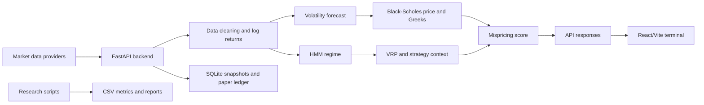

# NIFTY 50 Options Mispricing Detection Engine

Research and decision-support software for analysing NIFTY 50 index options with volatility models, option pricing, regime classification, and backtesting tools.

## What is this?

This project is a quantitative finance terminal. It collects NIFTY 50 market data, estimates volatility, calculates theoretical option prices, compares those prices with observed option prices, and displays the results in a web interface.

In simple terms: the system asks, **“Does this option price look different from a model-based reference price, and what market conditions might explain the difference?”**

> **Explain like I’m 10:** Imagine a shop selling a toy. We estimate a reasonable price using the toy’s size, age, and popularity. If the shop price is very different, we mark it for investigation. The system does the same for options, but with mathematics and market data.

## Problem it solves

Options are affected by the underlying index price, strike price, time remaining, interest rates, dividends, and volatility. Looking at every contract manually is difficult.

The project helps users:

- inspect NIFTY 50 prices and option chains;
- estimate future volatility;
- calculate Black–Scholes–Merton reference prices and Greeks;
- compare market prices with model prices;
- classify volatility regimes;
- inspect strategy recommendations and backtest results;
- monitor paper-trading records and risk information.

The output is **research and decision support**. It is not proof that an option is economically mispriced, arbitrageable, or profitable to trade.

## What the project does

### Main features

- **Market data:** Fetches NIFTY data through `yfinance` and option-chain data through the project’s live-data integrations.
- **Log returns:** Converts closing prices into continuous returns.
- **Volatility forecast:** Fits an EGARCH-based forecast and combines daily and intraday realised-volatility inputs when intraday data is available.
- **Regime classification:** Uses a Gaussian Hidden Markov Model (HMM) to label volatility as low, normal, high, or extreme.
- **Option pricing:** Calculates Black–Scholes–Merton prices with a continuous dividend yield.
- **Greeks:** Calculates delta, gamma, theta, and vega.
- **Implied volatility:** Estimates implied volatility from an observed option price when the calculation is valid.
- **Mispricing score:** Combines price deviation, Greeks-related components, timeframe coherence, and volatility-risk-premium deviation.
- **Strategy suggestions:** Produces structured long-volatility, short-volatility, or no-trade suggestions.
- **Backtesting:** Provides a walk-forward options backtest and separate research backtesting tools.
- **Paper trading:** Stores paper-trading snapshots and trades in SQLite.
- **Frontend terminal:** Provides workspaces for overview, option chains, volatility, mispricing, strategies, backtests, paper trading, risk, and model information.

## Who it is for

- Quantitative-finance students and researchers.
- Software-engineering interviewers and project reviewers.
- Traders who want an experimental analytics dashboard.
- Developers learning how a data pipeline becomes an API and user interface.
- New contributors who need a starting point for the repository.

## How it works



> **Explain like I’m 10:** Data enters the factory. Different machines clean it, measure market mood, estimate option value, and check for unusual differences. The dashboard is the factory control screen.

## Technology stack

| Technology | Why it is used |
|---|---|
| Python | Backend services and research scripts |
| FastAPI | HTTP API and WebSocket server |
| Uvicorn | Development and production-style Python server process |
| Pandas / NumPy | Tables, arrays, returns, and numerical calculations |
| `arch` | GARCH and EGARCH volatility modelling |
| `hmmlearn` | Gaussian HMM regime classification |
| SciPy | Probability distributions and Black–Scholes calculations |
| SQLite | Local snapshots and paper-trading persistence |
| React | Frontend user interface |
| TypeScript | Typed frontend code |
| Vite | Frontend development server and build tool |
| Tailwind CSS | Frontend styling |
| ECharts / Lightweight Charts | Charts and market visualisation |
| Docker | Container packaging |

## Screenshots and demo

Screenshots are not currently documented in the repository.

- `[NEEDS INPUT: Add a dashboard screenshot here.]`
- `[NEEDS INPUT: Add a short hosted-demo URL if one exists.]`

## Quick start

### Prerequisites

- Python 3.10 or a compatible Python version supported by the installed dependencies.
- Node.js and npm for the frontend.
- Internet access for live provider requests.
- Optional: Docker.
- The `data/` directory is ignored by Git. Required local datasets or SQLite files must be obtained separately.

### Backend

From the repository root:

```powershell
python -m venv .venv
.venv\Scripts\Activate.ps1
pip install -r requirements.txt
uvicorn main:app --reload --port 8000
```

The API is normally available at `http://localhost:8000`.

Useful URLs:

- `http://localhost:8000/docs` — FastAPI interactive API documentation.
- `http://localhost:8000/health` — health check.
- `http://localhost:8000/api/status` — basic status response.

### Frontend

```powershell
cd frontend
npm install
npm run dev
```

The Vite development server prints its local URL. The frontend API client uses the backend on port `8000` when the frontend runs on port `3000`.

### Docker

```powershell
docker build -t nifty-options-engine .
docker run --rm -p 8000:8000 nifty-options-engine
```

The Docker image starts `uvicorn main:app`.

## How to use it

1. Start the backend.
2. Start the frontend.
3. Open the frontend URL.
4. Use the sidebar or keyboard shortcuts to open workspaces:
   - `1` Overview
   - `2` Option Chain
   - `3` Volatility Lab
   - `4` Mispricing Scanner
   - `5` Strategy Lab
   - `6` Backtesting
   - `7` Market Monitor
   - `8` Paper Trading
   - `9` Historical Ledger
   - `0` Risk Portfolio
   - `-` Pipeline Operations
   - `=` Model Registry
5. To inspect the API directly, open `/docs` and try an endpoint such as `/health`, `/nifty`, `/forecast-vol`, or `/option-chain`.

## Simplified folder structure

```text
.
├── main.py                 FastAPI application and endpoint definitions
├── backend/
│   ├── services/           Data, pricing, volatility, regime, strategy, and trade logic
│   └── infrastructure/     Timeframe and annualisation helpers
├── frontend/
│   ├── src/components/     Shared interface components
│   ├── src/workspaces/     Main terminal workspaces
│   └── src/services/       API, WebSocket, and chart helpers
├── scripts/                Research, ingestion, backtest, and paper-trading scripts
├── tests/                  Tests and audit checks
├── validation/             Validation utilities and outputs
├── docs/                   Existing technical and research documentation
├── data/                   Local ignored data and SQLite files
├── requirements.txt        Python dependencies
├── Dockerfile              Backend container definition
└── .env.example            Configuration template
```

## Limitations

- The `data/` directory is local and ignored by Git. A fresh clone does not contain the data files.
- Live and research pipelines are separate paths and should not be described as one fully validated system.
- Historical option records are primarily daily last-traded references, not guaranteed executable bid/ask quotes.
- The research data does not establish a complete historical order book or intraday quote history.
- Volatility models depend on data quality, sample size, convergence, and parameter choices.
- The HMM labels states by fitted volatility ordering; labels are not permanent economic truths.
- Paper trading is not live brokerage execution.
- Transaction costs, slippage, liquidity, and lot-size assumptions must be checked before interpreting returns.
- `[NEEDS INPUT: Confirm the supported deployment environment and exact production data-provider agreements.]`

## Roadmap

- Add a documented data-download workflow that does not commit large datasets.
- Add reproducible tests for each API and quantitative service.
- Separate live, paper, and research configuration more clearly.
- Add stronger historical bid/ask and liquidity data.
- Add transaction-cost and slippage models to backtests.
- Improve experiment manifests and automated report generation.
- Add authentication and role-based access if the system is deployed beyond a trusted local environment.
- `[NEEDS INPUT: Prioritised team roadmap and target release date.]`

## Team

- `[NEEDS INPUT: Your name]`
- Heet
- Shaurya

## License and contact

- License: `[NEEDS INPUT: Add the project license, or state that no license has been selected.]`
- Contact: `[NEEDS INPUT: Add a public contact, repository issue link, or team email.]`

